<p align="center">
  
</p>

<h1 align="center">Dayfold</h1>

<p align="center">
  <em>A self-hosted daily newspaper for your e-reader.</em><br>
  News from sources you choose, typeset every morning as a classic broadsheet, with a cartoon and puzzles at the end.
</p>

---

Dayfold runs on a home server and does all the heavy lifting: it collects news from feeds and
scrapers, picks and organizes the stories (by rules, or with an optional AI), draws the front page,
writes an EPUB with sections, a cartoon and games, and serves it to your Kindle. The e-reader only
downloads one file a day and reads it offline.

<p align="center">
  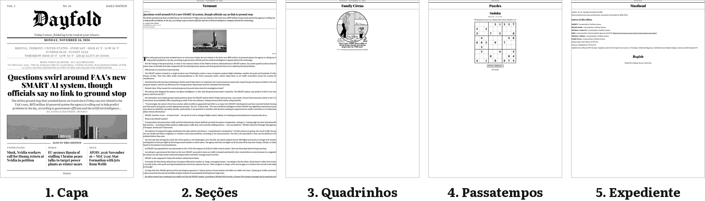
</p>

> The screenshots above were taken on a Kindle Paperwhite running KOReader and the Dayfold plugin.
> With KOmpanion, each edition also appears in the stock Kindle library with its front page as cover:

<p align="center">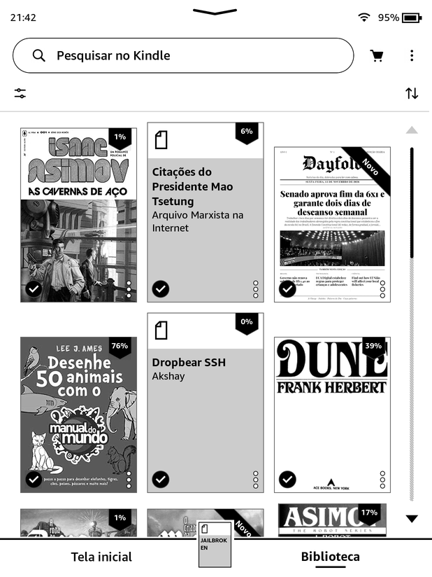</p>

## Features

* **Classic newspaper design** everywhere: blackletter masthead (Chomsky, an open font in the
  spirit of the New York Times nameplate), Playfair Display headlines and Literata body text,
  rules, kickers, bylines and columns. The dashboard looks like a newsroom, not a SaaS, with light and
  dark themes and an English/Portuguese switch with flags (English by default; both remembered by the browser).
* **Front page cover** rendered for e-ink (16 gray levels): masthead, date, edition number,
  headline, deck, lead photo or lead text in columns, and "also in this edition".
* **Sources you control**: RSS/Atom first, generic article extraction (Trafilatura) when there
  is no feed, and CSS selector scrapers for the rest. Scrapers are versioned, tested in an
  isolated process before activation, and can be rolled back.
* **License aware**: every provider declares how its content may be used
  (`metadata_only`, `excerpt_and_link`, `full_content_allowed`, `image_only`) and Dayfold stores only what that mode allows.
  `image_only` turns an RSS feed into comics: no story text is fetched or kept, the strips print in
  the section the provider declares (`Quadrinhos` is seeded for this, falling back to its category)
  rather than being matched by keywords, and each one gets a page like the cartoon — the strip's
  name on top (the feed's channel title, falling back to the provider name), then the title, the
  artwork, and the entry's alt text as the caption when it says more than the title does (the
  artwork always carries that description either way).
* **Story length caps**: full text stories can be capped by words and/or paragraphs for the
  whole paper, per section or per provider (the most specific wins). A capped story ends at the
  last sentence that fits, with a "The story continues online" note and the link. Caps apply when
  the edition is typeset, so `retypeset` reshapes an existing edition without collecting again.
* **Curation without AI** by section keywords, recency, deduplication and per source limits.
* **Rate edition**: mark each story as more of this, neutral or less of this; the next editions
  learn from it (source, section and title words), with or without AI.
* **Optional AI** (OpenAI compatible APIs, Ollama, Anthropic, or a local CLI such as Claude Code or Codex) for:
  editorial selection over pre-filtered candidates, the daily cartoon, and AI assisted scraper generation.
  Everything else keeps working without it.
* **Daily cartoon** (needs AI): the model picks the story and writes the gag, and an image model
  draws a newspaper style ink illustration. Works with Codex CLI (image generation with your
  ChatGPT account, no API key) or any OpenAI compatible image API. Without an image model it
  falls back to a simple line drawing rendered by the server.
* **Games** prepared on the server: Sudoku (unique solution), Word of the Day (Wordle style),
  Word Search (themes or words from the day's headlines) and a free-form Crossword with clues, in
  Portuguese or English.
* **English or Portuguese editions**: the edition language (Newspaper › Identity, English on new
  installs) sets labels, dates, the default section names and tagline, and the word games, which
  follow the edition unless one is set to a language of its own. It is separate from the dashboard
  switch, and the dashboard points it out when the two differ.
* **KOReader plugin**: sync over Wi-Fi, interactive games with saved progress, and a continuous
  flow from the news to the cartoon and the puzzles. Its menus follow the KOReader language
  (English, with a Portuguese catalog in `l10n/pt.po`; more languages are one `.po` file away).
* **Sleep screen** (optional, off by default): the latest front page as the Kindle sleep screen,
  in KOReader and, with the Dayfold agent, in the stock Kindle interface.
* **Kindle agent** (optional): new editions are downloaded on wake and every 30 minutes while awake
  (Wi-Fi already on) and show up as the first book in the library, no KOReader needed.
* **Distribution**: dashboard download, token protected feed (`/feed/latest.epub`), OPDS catalog.
* Built for a home server: one Python process, SQLite, a persistent job queue and a daily schedule.

## Screenshots

| Newsroom (overview) | Newspaper settings and live typography preview |
| --- | --- |
|  | 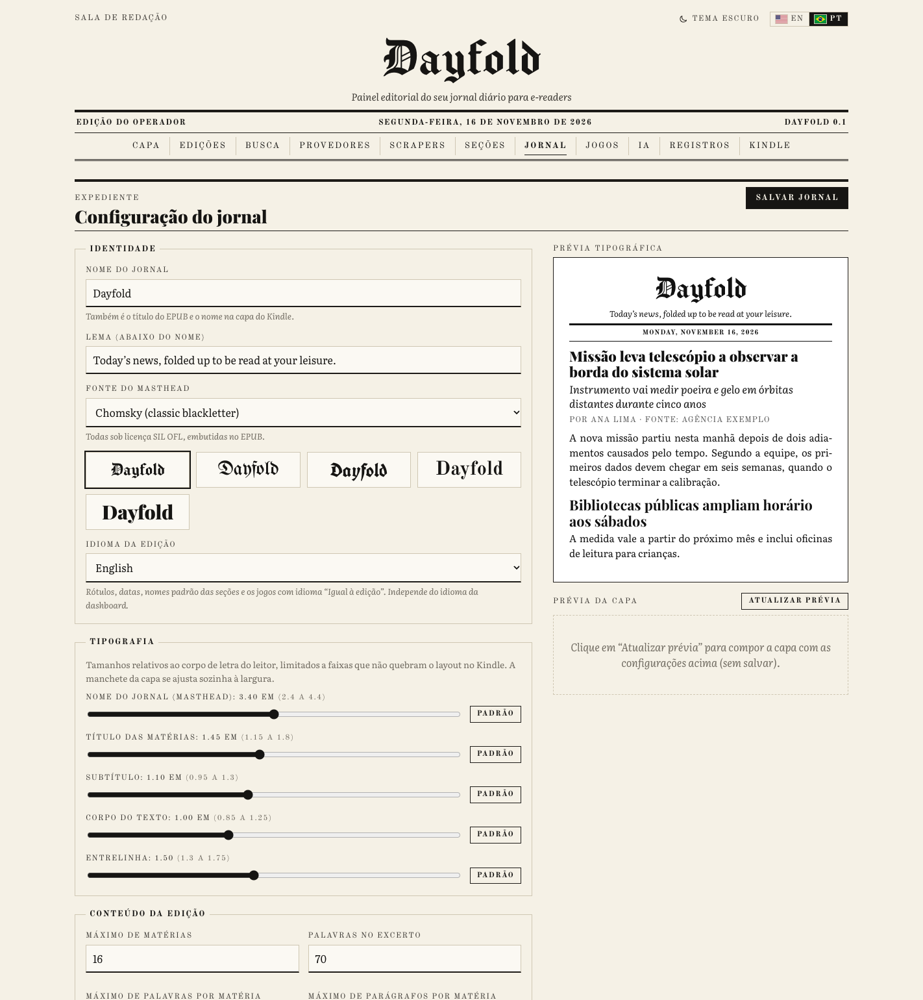 |
| **Providers with license and usage mode** | **Scraper versions, test report and rollback** |
| 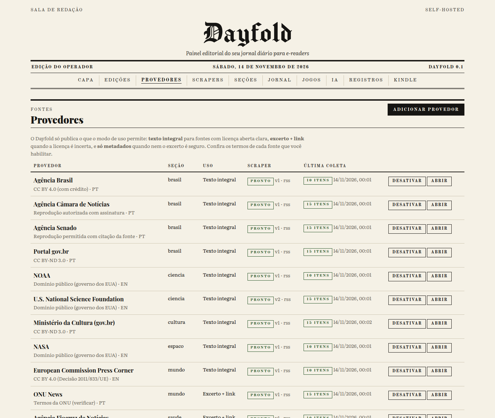 | 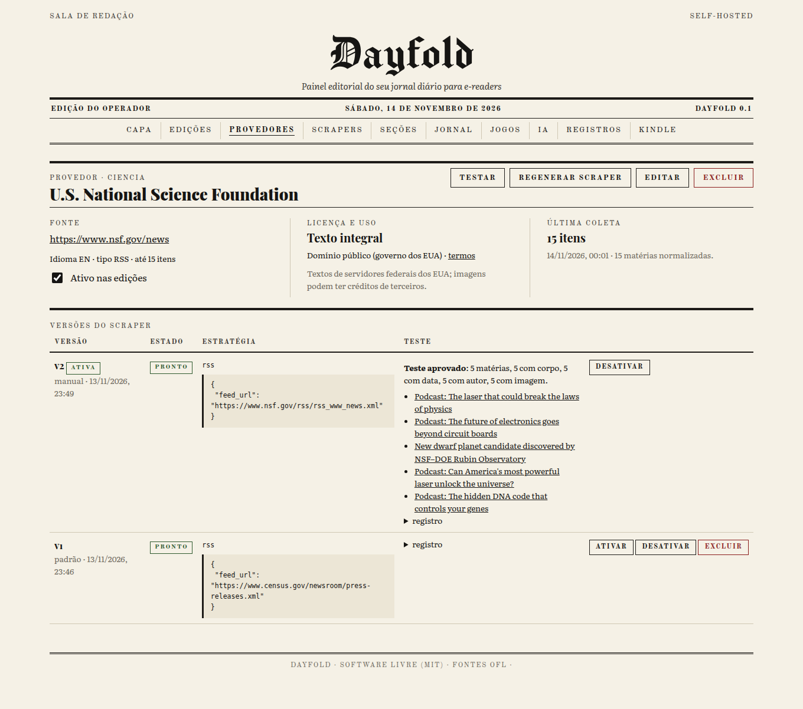 |
| **Edition details** | **Games configuration and preview** |
| 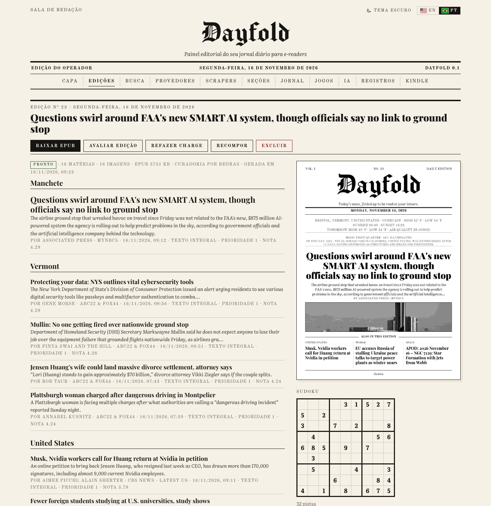 | 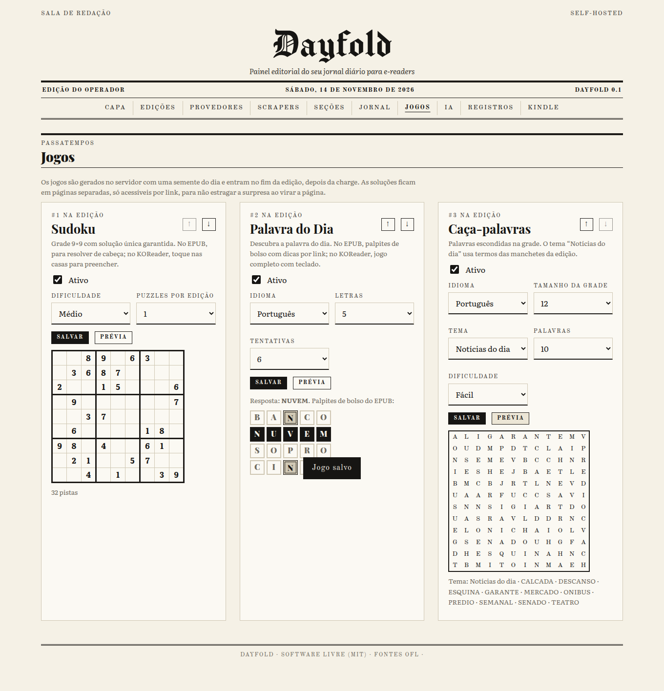 |

On the Kindle:

| Front page | Cartoon | Puzzle page in the EPUB | Pocket Wordle (plain EPUB) |
| --- | --- | --- | --- |
|  |  |  | 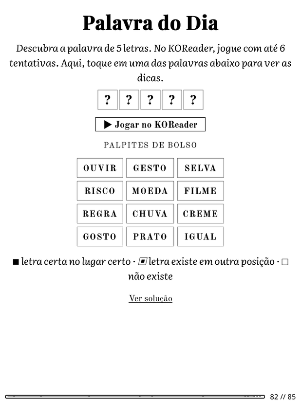 |
| **Sudoku in KOReader** | **Word of the Day in KOReader** | **Word Search in KOReader** | **End of the edition** |
| 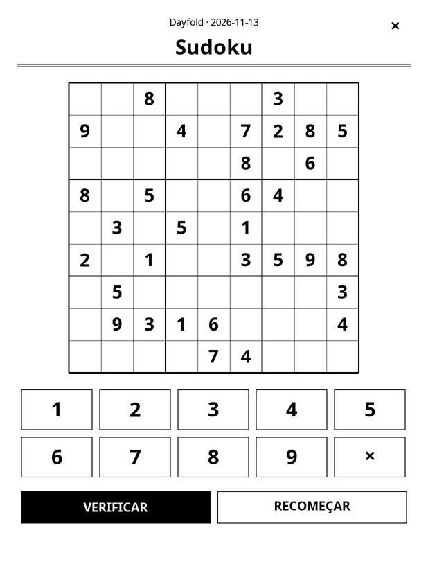 | 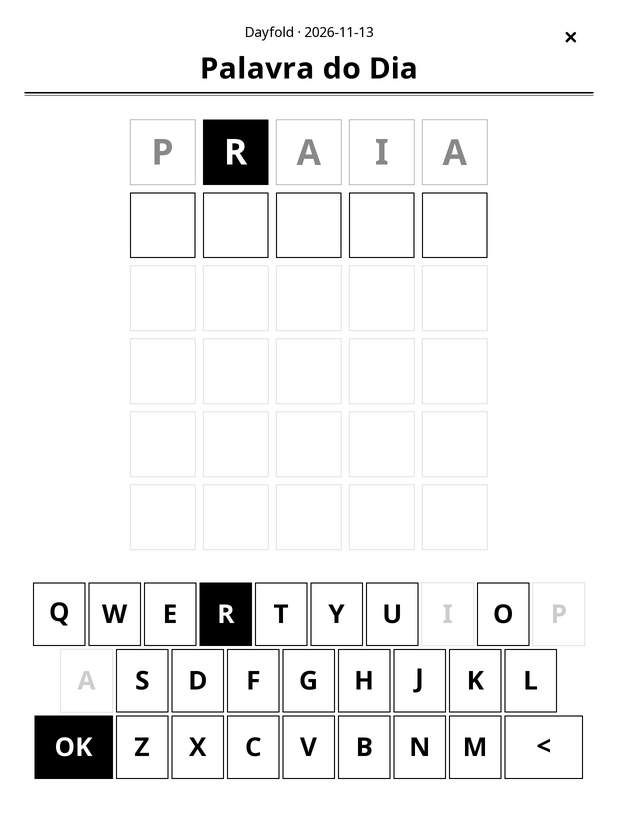 | 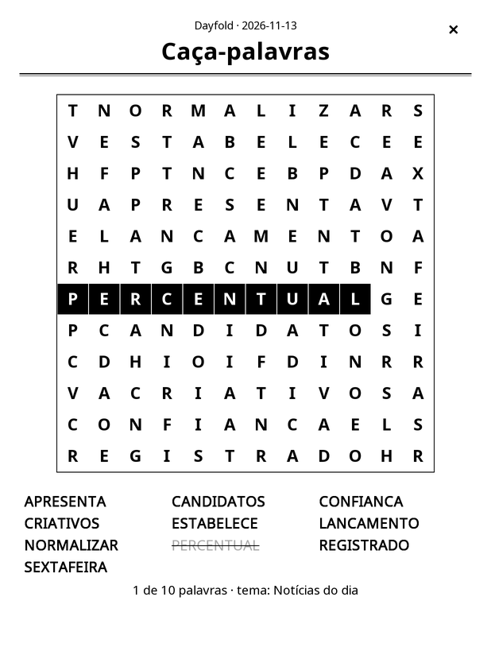 | 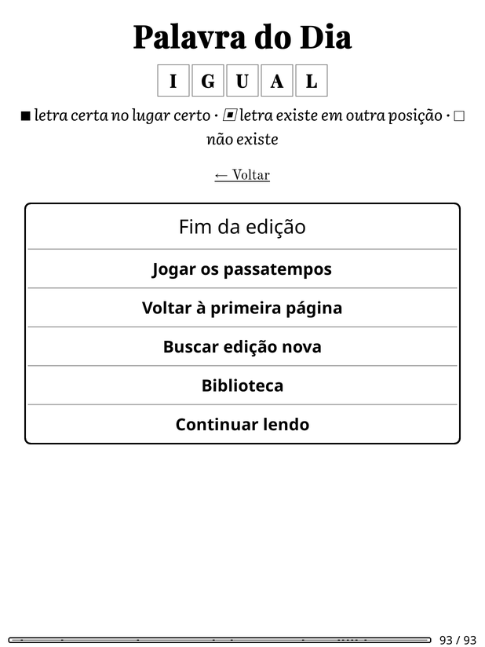 |

## Quick start

### Docker

```bash
git clone https://github.com/JonathanLemes/dayfold.git
cd dayfold/deploy
DAYFOLD_PASSWORD=choose-one DAYFOLD_LANGUAGE=en docker compose up -d --build
```

`DAYFOLD_LANGUAGE` picks the server's own language (`pt` or `en`, default `pt`); without it the
compose file reads the variable from your shell or from a `.env` file next to `docker-compose.yml`.
The full list is in the table below.

Open `http://SERVER:8422`, press **Print today's paper** and download the EPUB.

### From source (systemd user service)

Requirements: Python 3.12+ with [uv](https://docs.astral.sh/uv/), Node 20+ with pnpm, Linux with systemd.

```bash
git clone https://github.com/JonathanLemes/dayfold.git
cd dayfold
make install          # uv sync, pnpm build, installs and starts dayfold.service (port 8422)
```

Settings live in `~/.config/dayfold/env` (see `deploy/env.example`):

| Variable | Default | Meaning |
| --- | --- | --- |
| `DAYFOLD_PORT` | `8422` | HTTP port |
| `DAYFOLD_HOST` | `0.0.0.0` | Bind address |
| `DAYFOLD_DATA_DIR` | `~/.local/share/dayfold` | Database and editions |
| `DAYFOLD_PASSWORD` | unset | Dashboard password. Without it the dashboard is open to your network |
| `DAYFOLD_DISABLE_SCHEDULER` | unset | `1` disables the daily schedule |
| `DAYFOLD_LANGUAGE` | `pt` | `pt` or `en`. Language of the server's own text (API errors, labels, job logs) and of the newspaper on a fresh install. From then on the newspaper's language is a setting of its own |

Other commands:

```bash
make dev-backend      # API with auto reload on :8422
make dev-frontend     # Vite dev server on :5173 (proxies the API)
make generate         # generate an edition in the foreground
make test             # backend tests
cd backend && uv run dayfold retypeset 12   # re-typeset edition 12 with the current settings
```

## Using it

1. **Newspaper**: name of the newspaper (also the EPUB title), masthead font, type sizes (limited to
   ranges that keep the Kindle layout intact), number of stories, sections, schedule, cartoon and games,
   closing order (news, cartoon, games). The cover preview renders with unsaved settings.
2. **Sections**: sections and their keywords. Keywords drive the rule based curation and guide the AI.
3. **Providers**: enable sources, set their usage mode and license notes, test them, add new ones
   manually (feed, generic extraction or CSS selectors) or with assisted creation.
4. **Scrapers**: every version with its state (`PENDING`, `GENERATING`, `TESTING`, `READY`,
   `FAILED`, `DISABLED`). A new version replaces the active one only after it passes its test.
5. **AI**: add a provider, test it, activate it. Presets for Claude Code CLI, Codex CLI,
   Anthropic, OpenAI, Ollama and OpenRouter. For illustrated cartoons, set an image model (API) or an
   image command (CLI agent that can draw, e.g. `codex exec --skip-git-repo-check -s workspace-write --ephemeral -`).
   Each edition page has **Redo cartoon** to draw a new cartoon and **Re-typeset** to rebuild the cover and EPUB with the current settings.
6. **Games**: enable, order and configure Sudoku, Word of the Day, Word Search and Crossword, with previews.
7. **Logs**: every generation with its steps and log. **Print today's paper** works from the
   front page or from here.

## Connecting the e-reader

Short version for a jailbroken Kindle with SSH and KPM:

```bash
make kindle-koreader                                   # installs KOReader via KPM
make kindle-install SERVER=http://192.168.0.10:8422    # plugin, config and today's edition
make kindle-library                                    # optional: editions in the stock Kindle library
make kindle-agent                                      # optional: new editions land in the library by themselves
```

With `kindle-library`, each edition shows up in the Kindle library with its front page as cover
("Dayfold · Nov. 13, 2026") and opens in KOReader. Otherwise open KOReader on the Kindle: menu › **Tools** › **Dayfold** › **Download today's edition**.
OPDS and direct download also work with any reader. **Kindle without jailbreak:** choose "No
jailbreak" on the dashboard Kindle page and fill in your Gmail and `@kindle.com` addresses; each
edition is e-mailed to Send to Kindle. The full guide, including manual install
over USB, the sleep screen cover and troubleshooting, is in [docs/KINDLE.md](docs/KINDLE.md).

## AI, tokens and battery

* AI is never required. Without it you get rule based curation and no cartoon.
* The model only sees candidates that survived deterministic filters, as one line each
  (id, section, source, title, 30 words). It returns JSON that is validated; invalid answers fall
  back to the rules. A typical curation call is about 2,500 input tokens.
* The model never rewrites articles.
* Scraper generation sends a trimmed HTML sample (no scripts, styles or attribute noise) and only
  after feed discovery and generic extraction failed. The AI produces a selector spec, never code.
* The Kindle only downloads and reads; images are grayscale and sized on the server.

## Limitations

* **Copyright.** Dayfold cannot verify licenses for you. The defaults favor public sources and
  open licenses, and unknown sources default to excerpt and link, but you are responsible for the
  sources you enable. Read [docs/LICENSING.md](docs/LICENSING.md).
* **Interactive games and EPUB.** EPUB readers do not run scripts. In a plain EPUB the puzzles are
  printed (solve them in your head or on paper), the Word of the Day becomes a "pocket" version with
  a fixed set of tappable guesses, and solutions are behind links. Full interactivity (typing,
  checking, saved progress, end of edition dialog) needs KOReader with the Dayfold plugin.
* **Kindle.** The stock Kindle software does not open EPUB, and KOReader requires a jailbroken
  Kindle. Without a jailbreak, Dayfold sends a native Kindle version through Amazon's Send to
  Kindle (automatically from your Gmail, or by hand): no interactive games, but the printed puzzles,
  the pocket Word of the Day and the solutions work (validated on a Kindle Paperwhite 5).
* **Scrapers** depend on the sites. Feeds are stable; selector scrapers break when a site changes,
  which is why versions, tests and rollback exist.
* **Cartoons** look like real illustrations only in illustrated mode, which needs an image capable
  AI (Codex CLI with image generation, or an image API) and takes one to two minutes. The fallback
  structured mode is a simple line drawing with a limited set of poses and props.
* Single user. The dashboard has one optional password, and feeds use a single token.

## Architecture

```
backend/      FastAPI app, pipeline, scrapers, AI adapters, EPUB and cover rendering, games
frontend/     React + TypeScript dashboard (served by the backend in production)
koreader/     dayfold.koplugin for KOReader (sync, end of edition flow, interactive games)
kindle/       install scripts for a jailbroken Kindle over SSH
deploy/       systemd unit, Dockerfile, docker-compose
docs/         architecture, Kindle guide, licensing, screenshots
```

Details, data model and flows: [docs/ARCHITECTURE.md](docs/ARCHITECTURE.md).

## License

Code under the [MIT License](LICENSE). Bundled fonts under the SIL Open Font License 1.1.
News content belongs to its publishers; see [docs/LICENSING.md](docs/LICENSING.md).
